  

  <a href="https://kirashop.id.vn">Portfolio</a>
  &nbsp;·&nbsp;
  <a href="https://kiralc.io.vn">Live product</a>
  &nbsp;·&nbsp;
  <a href="https://github.com/AkiyamaKira2003?tab=repositories">Repositories</a>

### Hello, I'm Kira 👋

I enjoy turning ideas into **useful, well-crafted software** — from expressive web interfaces to small tools that make everyday workflows simpler. I care about the details: responsiveness, performance, clarity and dependable behavior.

- **I build:** interactive websites, practical automations and desktop utilities.
- **I focus on:** user experience, performance, reliability and maintainable systems.
- **I explore:** browser automation, developer tooling and constraint-based puzzle generation.

### Featured work

| Project | What it does | Explore |
| --- | --- | --- |
| **KiraShop** | Personal developer space with interactive visuals and a playable Sudoku experience. | [Live website](https://kirashop.id.vn) |
| **Kira LC** | Responsive dashboards for viewing in-game currency rates across games and servers. | [Live website](https://kiralc.io.vn) |
| **RateLineageVN** | Public JavaScript project for tracking Lineage currency rates. | [Source](https://github.com/AkiyamaKira2003/RateLineageVN) · [Demo](https://rate-lineage-vn.vercel.app) |
| **KiraUI** | A Lua UI library for building Roblox interfaces. | [Source](https://github.com/AkiyamaKira2003/KiraUI) |

### More things I've built

- **[FarmTimerOverlay](https://github.com/AkiyamaKira2003/FarmTimerOverlay)** — a C# desktop overlay utility.
- **[Quick-text-manager](https://github.com/AkiyamaKira2003/Quick-text-manager)** — a desktop text-snippet manager with configurable game/chat overlays and hotkeys.

### Technologies I work with

`TypeScript` · `JavaScript` · `React` · `Next.js` · `Node.js` · `Python` · `C#` · `Lua` · `Cloudflare`

I prefer choosing technology to fit the problem rather than the other way around.

---

  Built with care · Keep learning, keep shipping.

